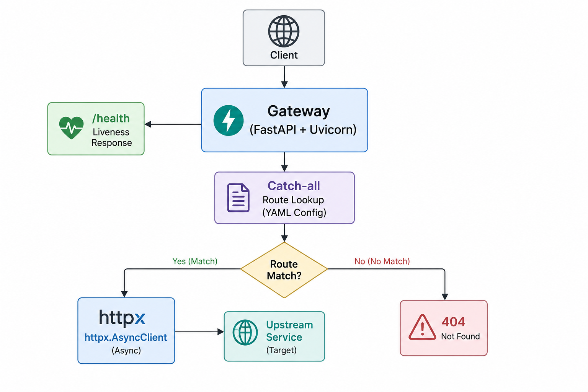

# async-gateway-proxy


An async API gateway / reverse proxy in Python. It receives HTTP requests,
picks a backend from a YAML routing table, forwards the request, and returns
the backend's response. It is built to sit in front of a custom multithreaded
C++ HTTP server.

The project is built in phases. This README describes what exists now
(up to Phase 7: core proxy, request tracing, API key auth, rate limiting,
retries, circuit breaking, streaming, graceful shutdown, metrics, readiness
and hot reload). Later phases are listed under [Roadmap](#roadmap).

## Architecture



What happens to one request:

1. Uvicorn accepts the TCP connection, parses the HTTP request and hands it
   to FastAPI as an ASGI call.
2. The request ID middleware gives the request an ID (the client's own
   `X-Request-ID` if it is well formed, a new UUID if not). Every log line
   for this request carries that ID.
3. The auth middleware checks the `X-API-Key` header. No key or an unknown
   key means `401`. `/health` needs no key.
4. The rate limit middleware takes one token from the client's bucket. An
   empty bucket means `429` with `Retry-After`.
5. `/health` is answered directly. Every other path hits one catch-all route.
6. `router.py` finds the longest `path_prefix` that matches the path. No
   match means `404`. If the key isn't allowed on that route, `403`.
7. `proxy.py` builds the upstream URL (prefix removed, query string kept as
   sent), cleans the headers (the API key is removed), adds `X-Request-ID`
   and `X-Gateway-Client`, and sends the request through a single shared
   `httpx.AsyncClient`. If the upstream's circuit breaker is open, it fails
   fast with `503` instead. A failed attempt that is safe to retry is tried
   again after a random backoff, while the retry budget allows.
8. The upstream's status, headers and body go back to the client with the
   same `X-Request-ID`. A timeout becomes `504`; a connection failure
   becomes `502`. One `request_completed` line is logged at the end.

Everything is async. While one request waits on its upstream, the event loop
serves other requests on the same thread.

## Features

- **Config-driven routing.** Routes live in `config.yaml`, validated by
  Pydantic at startup. A bad config stops the gateway from starting and
  reports every problem at once.
- **Longest-prefix matching** on path-segment boundaries: `/api` matches
  `/api/x` but not `/apix`.
- **Full forwarding** of method, path, raw query string, headers and body.
- **Header handling per RFC 7230:** hop-by-hop headers are dropped in both
  directions, including any header named in `Connection`. `Host` and
  `Content-Length` are set fresh for the upstream. `X-Forwarded-For` is
  appended to, never overwritten. Apart from the `X-Forwarded-*`,
  `X-Request-ID` and `X-Gateway-Client` headers, the gateway adds nothing
  of its own.
- **Streaming in both directions.** Response bodies are passed on chunk by
  chunk as they arrive; request bodies over 1 MiB are streamed to the
  upstream. Gateway memory stays flat: a 200 MB download peaks at 74 MB
  RSS (65 MB idle), against 491 MB when buffered. A slow stream's first
  byte arrives in 4 ms instead of after the whole body.
- **Bodies pass through untouched.** A gzipped upstream response reaches the
  client still gzipped, with its `Content-Encoding` intact. The upstream's
  `Content-Length` is kept. Repeated headers such as `Set-Cookie` are kept.
- **Graceful shutdown.** On SIGTERM the gateway stops accepting connections,
  lets in-flight requests and streams finish (up to 25 s), then closes its
  upstream connection pool.
- **Connection pooling.** One `httpx.AsyncClient` for the life of the
  process, so keep-alive connections to each upstream are reused.
- **Prometheus metrics** on a separate admin port (9100): request rates and
  latency histograms per route, upstream attempts by outcome, retries,
  breaker states, auth and rate-limit rejections, config reloads.
- **Liveness and readiness.** `/health` says the process is alive; `/ready`
  says it can serve. A dead upstream doesn't make the gateway unready.
- **Hot reload.** Edit `config.yaml` and it applies within 5 s, or at once
  with `kill -HUP`. Invalid files are rejected and the old config keeps
  serving. Each request runs under exactly one config version.
- **Distinct failure codes.** `504` for upstream timeout, `502` for an
  unreachable upstream, upstream `5xx` passed through as is.
- **Request IDs end to end.** Each request gets an ID that appears in every
  log line, goes to the upstream as `X-Request-ID`, comes back to the client
  in the response header and in error bodies. A client's own ID is kept if
  it is 1 to 128 characters of letters, digits and `. _ : -`; anything else
  is replaced.
- **API key auth.** Each key belongs to a named client and lists the routes
  it may use. Only SHA-256 hashes of keys are stored in config. The key is
  stripped before forwarding; the upstream gets the verified client name in
  `X-Gateway-Client` instead, and a client-sent copy of that header is
  always dropped. A client can hold two keys at once for rotation.
- **Rate limiting.** A token bucket per client (per IP with auth off),
  with a default and optional per-client limits. Buckets live in memory
  for one process, or in Redis so every gateway process and replica shares
  them. The Redis check is one atomic Lua script. If Redis goes down the
  gateway fails open by default, or closed if configured.
- **Retries.** Safe failures are retried with exponential backoff and full
  jitter: connect failures for any method, `502`/`503`/`504` and broken
  connections only for idempotent methods, timeouts never. A per-upstream
  retry budget caps retries at 20% of recent traffic.
- **Circuit breakers.** One per upstream. After 5 failures in a row the
  gateway answers `503` at once for 10 s, then lets one probe through.
- **Structured JSON logs.** A `request_completed` line for every request
  (total `duration_ms`) and a `proxy_forward` line for every forwarded one
  (`upstream_ms`, request and response sizes). The gap between the two
  times is the gateway's own overhead.

## Project layout

```
app/
  main.py            app factory, lifespan, /health, catch-all route
  server.py          process start-up (`python -m app`): server flags, metrics port
  metrics.py         Prometheus metrics, one registry per app
  health.py          readiness checks for /ready
  router.py          route matching and upstream URL building (pure functions)
  proxy.py           forwarding, header filtering, error mapping
  logging_config.py  JSON log formatter, request ID on every record
  request_context.py ContextVar holding the current request ID
  security.py        API key hashing, and a CLI to create keys
  middleware/
    request_id.py    assigns the ID, sets the response header, access log
    auth.py          checks X-API-Key (authentication)
    rate_limit.py    token bucket check per client, 429 and limit headers
  ratelimit/
    base.py          the token bucket algorithm
    memory.py        buckets in this process
    redis_backend.py buckets in Redis, shared, via a Lua script
  resilience/
    retry.py         what to retry, backoff with jitter, retry budget
    breaker.py       circuit breaker state machine
    guards.py        one budget and one breaker per upstream
  config/
    models.py        Pydantic schema for config.yaml
    loader.py        reads and validates the YAML file
    reload.py        hot reload: watch, validate, swap
dummy_upstream/
  main.py            small FastAPI backend for local testing
tests/               pytest suite, no network needed
config.yaml          routing table
```

## Run it locally

Needs Python 3.12 or newer.

```bash
python -m venv .venv
source .venv/bin/activate
pip install -r requirements-dev.txt

# Terminal 1: the backend
uvicorn dummy_upstream.main:app --port 8001

# Terminal 2: the gateway
python -m app
```

`python -m app` starts uvicorn with the flags a gateway needs, set in one
place (`app/server.py`) so they can't be forgotten:

- **No proxy headers.** By default uvicorn trusts `X-Forwarded-For` from
  localhost and rewrites the client address from it. The gateway is the
  edge, so it must record the real TCP peer, not a value the caller can fake.
- **No access log.** The gateway writes its own `request_completed` JSON
  line for every request; uvicorn's would only duplicate it.
- **Graceful shutdown timeout.** How long to wait for in-flight requests
  after SIGTERM before cutting them off.

Environment variables:

| Variable                           | Default       | Purpose                              |
|------------------------------------|---------------|--------------------------------------|
| `GATEWAY_CONFIG`                   | `config.yaml` | Path to the routing config           |
| `LOG_LEVEL`                        | `INFO`        | Log level                            |
| `GATEWAY_HOST`                     | `127.0.0.1`   | Listen address (`0.0.0.0` in Docker) |
| `GATEWAY_PORT`                     | `8000`        | Listen port                          |
| `GATEWAY_GRACEFUL_TIMEOUT_SECONDS` | `25`          | Max drain time after SIGTERM         |
| `GATEWAY_METRICS_PORT`             | `9100`        | Prometheus metrics port; `0` = off   |

## Configuration

```yaml
upstream_timeout_seconds: 5.0     # optional, must be > 0

routes:                           # at least one route
  - path_prefix: /api             # must start with '/'
    upstream: http://localhost:8001

  - path_prefix: /cpp             # e.g. the C++ server
    upstream: http://localhost:8080
```

Validation rules: unknown keys are rejected (so a typo like `upstrem` fails
at startup), upstreams must be full URLs with a scheme, and duplicate
prefixes are rejected. Trailing slashes are normalized.

## Authentication

Add an `auth` section and every request except `/health` needs an
`X-API-Key` header. Remove the section and auth is off (the gateway logs a
warning at startup).

```yaml
auth:
  keys:
    - client: mobile-app                  # logged, and sent upstream
      key_sha256: 1968b315...             # SHA-256 of the key, never the key
      routes: [/api]                      # route prefixes this key may use
```

Create a key:

```bash
python -m app.security mobile-app --routes /api
```

It prints the key once, for the client, and the YAML entry with its hash.

| Request                              | Response |
|--------------------------------------|----------|
| No `X-API-Key`                       | `401` `missing api key` |
| Unknown key                          | `401` `invalid api key` |
| Valid key, route not in its `routes` | `403` |
| Valid key, path matches no route     | `404` |
| Valid key, allowed route             | proxied |

Design choices:

- **401 before routing.** Without a valid key every path returns 401, so a
  caller can't probe which routes exist. Authentication (who are you?) is
  middleware; authorization (may you use this route?) runs after routing,
  because it needs the matched route.
- **Hashes, not keys, in config.** The config file can sit in git or a
  Kubernetes ConfigMap without leaking a usable key. SHA-256 is enough
  because keys are 256 random bits; slow password hashes like bcrypt exist
  for guessable human passwords and would add ~100 ms per request.
- **Lookup by hash.** The presented key is hashed, then looked up in a
  dict. Comparing raw strings can leak through timing how much of a guess
  was right; comparing hashes the attacker can't steer leaks nothing useful.
- **Keys never reach upstreams or logs.** Even a wrong key isn't logged,
  since it is often a real key pasted in the wrong place.
- **Rotation.** List a second key for the same client, move the client to
  it, then delete the old entry.

## Rate limiting

```yaml
rate_limit:
  backend: memory          # memory (one process) or redis (shared)
  default:
    capacity: 20           # biggest burst
    refill_per_second: 10  # long-run average rate
  # backend: redis
  # redis_url: redis://localhost:6379/0
  # redis_timeout_seconds: 0.25
  # fail_open: true        # Redis down: allow (true) or 429 (false)

auth:
  keys:
    - client: batch-job
      key_sha256: ...
      routes: [/api]
      rate_limit:          # optional, overrides the default for this client
        capacity: 100
        refill_per_second: 50
```

Every limited response carries `X-RateLimit-Limit` and
`X-RateLimit-Remaining`. Over the limit:

```
HTTP/1.1 429 Too Many Requests
retry-after: 1
x-ratelimit-limit: 20
x-ratelimit-remaining: 0

{"error":"rate limit exceeded","request_id":"..."}
```

Design choices:

- **Token bucket, not a fixed window.** "100 per minute" lets a client send
  100 at 0:59 and 100 more at 1:00. A bucket has no window edges, so a burst
  is never more than `capacity`.
- **Lazy refill.** Nothing ticks in the background. A bucket stores its
  tokens and when it was last touched, and adds what it earned on the next
  request. One O(1) check per request.
- **After auth.** The limiter needs to know who is calling. Requests that
  fail auth never reach it, so they don't drain anyone's bucket.
- **Per client, not per key.** A client's two keys during a rotation share
  one bucket instead of doubling its limit.
- **Why Redis.** In-memory buckets are per process: three replicas each
  allow the full limit, so a client gets three times its limit. Redis gives
  every replica the same buckets.
- **Atomic Lua script.** Done from Python as GET, compute, SET, two
  replicas can both read "1 token left". Against a real Redis, a naive
  GET/SET version let 50 of 50 concurrent requests through a limit of 10;
  the Lua script let through exactly 10. Redis runs a script without
  interleaving other commands.
- **Redis's clock.** The script uses Redis `TIME`, so replicas with
  slightly different clocks can't hand out extra tokens.
- **Keys expire.** Each bucket key expires once it would be full again; an
  idle client costs nothing in Redis.
- **Fail open by default.** If Redis is unreachable, requests go through
  and one error is logged every 10 s. Rate limiting protects the backends,
  but taking the whole API down because the limiter is down is usually
  worse. Set `fail_open: false` to reject with 429 instead.

Redis locally:

```bash
docker run --rm -p 6379:6379 redis:7-alpine   # or: brew install redis && redis-server
```

## Retries and circuit breaking

```yaml
retries:
  max_attempts: 3               # total, including the first try
  base_delay_seconds: 0.05
  max_delay_seconds: 1.0
  budget_ratio: 0.2             # retries <= 20% of recent requests per upstream
  budget_min_per_second: 1.0    # ...plus a small floor for quiet upstreams

circuit_breaker:
  failure_threshold: 5          # failures in a row before opening
  recovery_timeout_seconds: 10  # open this long, then one probe
```

Remove a section to turn that feature off.

**What gets retried:**

| Failure                                   | GET, HEAD, OPTIONS, PUT, DELETE | POST, PATCH |
|-------------------------------------------|---------------------------------|-------------|
| Connect failed (refused, DNS, connect timeout) | retried                    | retried     |
| Upstream answered `502`/`503`/`504`       | retried                         | no          |
| Connection broke after sending            | retried                         | no          |
| Read timeout                              | no                              | no          |
| Upstream answered `500` or `4xx`          | no                              | no          |

Design choices:

- **Retry only what is safe.** If the connection never opened, the request
  was never sent, so even a POST can go again. Once it was sent, the
  upstream may have acted on it, so only idempotent methods are retried; a
  retried `POST /payments` could charge a card twice.
- **No retry on timeouts.** A slow upstream is usually an overloaded one.
  Retrying adds load and multiplies the client's wait by the attempt count.
- **No retry on 500.** It usually means a bug that will fail the same way.
- **Full jitter.** Each wait is random between 0 and `base × 2^n` (capped).
  Fixed delays make clients that failed together retry together, and knock
  the upstream over again.
- **Retry budget.** Without one, every request retrying twice turns a
  struggling upstream's traffic into 3x, and it never recovers (a retry
  storm). Retries per upstream stay under 20% of the last 10 s of requests.
- **Circuit breaker per upstream.** Once an upstream has failed 5 times in a
  row, waiting on it is pointless. The gateway answers `503` with
  `Retry-After` in about a millisecond, the upstream gets room to recover,
  and after the timeout one probe request decides whether to close again.
  Other upstreams are unaffected.
- **Breaker and retries together.** Each attempt counts towards the
  breaker. When an attempt opens it, retrying stops at once, without
  waiting out the backoff.
- **The final answer.** If retries run out on a `503`, the client gets the
  upstream's own `503` body, which says more than a gateway error would.

What it looks like (dummy upstream killed after a few `503`s, then
restarted):

```
upstream_retry        /api/flaky   attempt 1  reason status  503  delay 18 ms
upstream_retry        /api/flaky   attempt 2  reason status  503  delay 90 ms
proxy_forward         /api/flaky   200  attempts 3
...
circuit_state_change  closed -> open
upstream_unreachable  /api/items/1  attempts 2  ConnectError
circuit_open_rejected /api/items/1  retry_after_s 10       (answered in 1 ms)
circuit_state_change  open -> half_open
circuit_state_change  half_open -> closed
proxy_forward         /api/items/1  200  attempts 1
```

## Streaming and graceful shutdown

**Responses** are streamed: each chunk from the upstream goes to the client
as it arrives, through `httpx`'s `aiter_raw()` and a Starlette
`StreamingResponse`. **Request bodies** up to `max_buffered_request_bytes`
(1 MiB) are held in memory, because only a body the gateway still holds can
be retried. Larger ones are streamed straight through and are not retried.

Measured on the same machine, 200 MB through the gateway:

| | Buffered (Phase 5) | Streaming (Phase 6) |
|---|---|---|
| Peak gateway RSS, 200 MB download | 491 MB | 74 MB (65 MB idle) |
| Peak gateway RSS, 200 MB upload | 491 MB | 74 MB |
| First byte of a 5-chunk stream sent 0.5 s apart | 2.0 s | 0.004 s |

Design choices:

- **Bytes pass through unchanged,** so the upstream's `Content-Length` stays
  correct and is kept. A streamed upload keeps the client's
  `Content-Length` too, instead of switching to chunked encoding, which
  some servers (and many hand-written ones) don't accept.
- **Backpressure.** Each chunk is handed to the server, which waits while
  the client's socket buffer is full. The gateway doesn't read more from
  the upstream until the client catches up, so a slow client slows the
  upstream read rather than filling the gateway's memory.
- **Buffer to retry.** Retries need the body twice. Small bodies (most API
  calls) are buffered and keep retries; big uploads stream and don't.
  Envoy makes the same trade-off with its retry buffer limit.
- **An upstream that breaks mid-body cuts the client off.** By then a `200`
  and its headers have been sent, so a clean `502` is impossible. The
  gateway aborts the connection, so the client sees a truncated transfer
  (curl exits with code 18) instead of a short body that looks complete.
  The access log line gets `"error": "UpstreamStreamError"`.
- **A client that hangs up releases the upstream.** The upstream connection
  is closed explicitly, not left for garbage collection, and a
  `client_disconnected` line is logged.

**Graceful shutdown** (SIGTERM, which is what Docker and Kubernetes send):
uvicorn stops accepting connections, waits for in-flight requests (streams
included) up to `GATEWAY_GRACEFUL_TIMEOUT_SECONDS`, then runs the app's
shutdown, which closes the upstream connection pool. Measured: SIGTERM 1 s
into a 2.5 s stream; the stream finished intact, a new request during the
drain was refused, and the process exited as soon as the stream ended.

## Observability and operations

### Metrics

`python -m app` serves Prometheus metrics at `http://localhost:9100/metrics`,
on a separate port from the API:

| Metric | Type | Labels |
|---|---|---|
| `gateway_requests_total` | counter | `route`, `method`, `status` |
| `gateway_request_duration_seconds` | histogram | `route` |
| `gateway_requests_in_flight` | gauge | |
| `gateway_upstream_attempts_total` | counter | `upstream`, `outcome` (success, connect, timeout, transport, status) |
| `gateway_upstream_retries_total` | counter | `upstream` |
| `gateway_retry_budget_exhausted_total` | counter | `upstream` |
| `gateway_circuit_breaker_state` | gauge | `upstream` (0 closed, 1 half-open, 2 open) |
| `gateway_circuit_open_rejections_total` | counter | `upstream` |
| `gateway_upstream_stream_aborts_total` | counter | `upstream` |
| `gateway_auth_rejections_total` | counter | `reason` (missing_key, invalid_key, route_not_allowed) |
| `gateway_rate_limited_total` | counter | `client` |
| `gateway_config_reloads_total` | counter | `result` (success, failed, rejected) |
| `gateway_config_last_success_timestamp_seconds` | gauge | |

Example queries:

```promql
# p99 latency per route over 5 minutes
histogram_quantile(0.99, sum by (le, route) (rate(gateway_request_duration_seconds_bucket[5m])))

# share of upstream attempts that failed
sum(rate(gateway_upstream_attempts_total{outcome!="success"}[5m]))
  / sum(rate(gateway_upstream_attempts_total[5m]))

# any breaker open?
max(gateway_circuit_breaker_state) == 2
```

Design choices:

- **Separate port.** The API port faces the internet; the metrics port is
  only reachable inside the cluster. Route names, client names and error
  rates help attackers too. `/metrics` on the API port is just another
  path, and needs a key like any other.
- **No raw paths as labels.** `route` is the matched prefix, so
  `/api/users/1` and `/api/users/2` are one time series, not two. Raw paths
  would create a series per URL and eventually overload Prometheus.
  Requests rejected before routing (401, 429) are labelled `none`.
- **Breaker state is read at scrape time,** with a read-only `peek_state()`.
  The metrics server runs in its own thread, so it must never change
  breaker state behind the event loop.
- **One registry per app,** not `prometheus_client`'s global one, so tests
  can build many apps side by side.

### Liveness and readiness

| Probe | Question | If it fails, Kubernetes... |
|---|---|---|
| `/health` | Is the process broken? | restarts the pod |
| `/ready` | Can it serve right now? | stops sending it traffic, no restart |

```json
{"status": "ready", "checks": {"config": "ok", "upstream_pool": "ok", "rate_limit_memory": "ok"}, "open_circuits": 0}
```

`/ready` fails (503) if the upstream connection pool is closed, or if rate
limiting uses Redis with `fail_open: false` and Redis is down, since then
every request would get 429. **It does not fail when an upstream is down.**
If one dead backend made every gateway pod unready, Kubernetes would pull
the whole gateway, and every healthy route would go down with it. Dead
upstreams are the circuit breaker's job; `/ready` only reports how many
breakers are open. It never lists upstream addresses, since it is public.

### Hot reload

Edit `config.yaml` and the gateway applies it within
`reload_interval_seconds` (5 s), or at once with `kill -HUP <pid>`. No
restart, no dropped connections. Routes, API keys, rate limits, retries,
breaker settings and timeouts can all change this way, so revoking a key
takes seconds.

- **Changes are found by hashing the file,** not by modification time. A
  Kubernetes ConfigMap update swaps a symlink, which mtime checks can miss.
- **Validated before use.** Broken YAML or an invalid rule is rejected,
  logged once with the reason (`config_reload_failed`), and the old config
  keeps serving. A typo can't take the gateway down.
- **Some settings need a restart.** Moving the rate limiter between memory
  and Redis (or changing its Redis settings) is rejected with
  `config_reload_rejected` instead of being half-applied.
- **Atomic swap, one config per request.** The new config is installed
  with one reference assignment. Each request takes a snapshot when it
  arrives, so a reload can't land halfway through a request, with auth
  under the old config and routing under the new.
- **Dependent state is reset.** If breaker or retry settings change, those
  breakers and budgets are rebuilt with the new values. State for upstreams
  that no longer appear in any route is dropped.
- **Watch for SIGHUP.** Without a handler, SIGHUP's default action is to
  terminate the process, so `kill -HUP` on a server that doesn't handle it
  shuts it down. The gateway installs one at startup.

## Try it

The bundled `config.yaml` has one key for local development only:
`gw_dev_local_only`. It's public, so delete it before deploying anywhere.

```bash
K="X-API-Key: gw_dev_local_only"

# Liveness, no key needed
curl localhost:8000/health
# {"status":"ok"}

# No key / wrong key
curl -i localhost:8000/api/items/42
# 401 {"error":"missing api key","request_id":"..."}
curl -i localhost:8000/api/items/42 -H "X-API-Key: nope"
# 401 {"error":"invalid api key","request_id":"..."}

# Proxied GET: /api/items/42 -> http://localhost:8001/items/42
curl localhost:8000/api/items/42 -H "$K"
# {"item_id":42,"name":"item-42"}

# The echo endpoint shows what the upstream received: no x-api-key,
# x-gateway-client: local-dev, even if the caller tries to fake it
curl localhost:8000/api/echo -H "$K" -H "X-Gateway-Client: admin"

# Proxied POST
curl -X POST localhost:8000/api/echo -H "$K" \
  -H "Content-Type: application/json" \
  -d '{"hello":"world"}'

# Your own request ID is kept, sent upstream, and returned
curl -i localhost:8000/api/echo -H "$K" -H "X-Request-ID: demo-42"
# x-request-id: demo-42   (and "x-request-id": "demo-42" in the echoed headers)

# No matching route
curl -i localhost:8000/nope -H "$K"
# 404 {"error":"no matching route","path":"/nope","request_id":"f046eddc-..."}

# Rate limit: the dev config allows a burst of 20, then 10/s
for i in $(seq 25); do curl -s -o /dev/null -w "%{http_code} " localhost:8000/api/items/1 -H "$K"; done; echo
# 200 x22 or so, then 429s: 20 from the burst, plus a few that refilled
# (10/s) while the loop ran

# Retries: this upstream endpoint fails twice, then succeeds.
# The client only sees the 200; the log shows two upstream_retry lines.
curl "localhost:8000/api/flaky?key=demo1&fail=2" -H "$K"
# {"ok": true, "call": 3}

# Retries run out: 3 attempts, then the upstream's own 503
curl -i localhost:8000/api/status/503 -H "$K"

# Streaming: lines arrive one by one, every 0.5 s (-N turns off curl's buffer)
curl -N "localhost:8000/api/stream?chunks=5&interval=0.5" -H "$K"

# 200 MB through the gateway; watch its memory stay flat
curl -o /dev/null "localhost:8000/api/large?mb=200" -H "$K"
head -c 200000000 /dev/urandom > big.bin
curl "localhost:8000/api/upload" -H "$K" --data-binary @big.bin
# {"bytes":200000000,"sha256":"...","content_length":"200000000",...}

# Graceful shutdown: start a slow stream, then Ctrl+C the gateway while it
# runs. The stream still completes; then the gateway exits.
curl -N "localhost:8000/api/stream?chunks=10&interval=0.5" -H "$K"

# Readiness, and metrics on the admin port
curl localhost:8000/ready
curl -s localhost:9100/metrics | grep ^gateway_requests_total

# Hot reload: add a route in config.yaml (and to the dev key's routes),
# save, and within 5 s it works. Or apply it at once:
kill -HUP $(pgrep -f "python -m app")

# A real timeout: the upstream waits 6 s, the gateway gives up after 5 s
curl -i "localhost:8000/api/slow?delay=6" -H "$K"
# 504 {"error":"upstream timeout","request_id":"..."}

# Circuit breaker: stop the dummy upstream, then repeat this a few times.
# The first requests retry and fail with 502; once 5 attempts in a row have
# failed the breaker opens, and the rest get 503 in about a millisecond.
# Restart the upstream, wait 10 s, and requests succeed again.
curl -i localhost:8000/api/items/1 -H "$K"
# first:  502 {"error":"upstream unavailable","request_id":"..."}
# later:  503 {"error":"upstream circuit open","request_id":"..."}  retry-after: 10
```

The two log lines for one proxied request share its ID, and the access line
names the client:

```json
{"ts": "2026-10-29T14:46:55.873+00:00", "level": "info", "logger": "gateway.proxy", "message": "proxy_forward", "request_id": "d254920c-ec7c-41ae-902f-3ee633e85b38", "method": "GET", "path": "/api/items/1", "upstream": "http://localhost:8001/items/1", "status_code": 200, "upstream_ms": 30.82, "request_bytes": 0, "response_bytes": 29}
{"ts": "2026-10-29T14:46:55.874+00:00", "level": "info", "logger": "gateway.access", "message": "request_completed", "request_id": "d254920c-ec7c-41ae-902f-3ee633e85b38", "method": "GET", "path": "/api/items/1", "status_code": 200, "duration_ms": 32.97, "client_ip": "127.0.0.1", "client": "local-dev"}
```

A rejected request:

```json
{"ts": "2026-10-29T14:46:55.832+00:00", "level": "warning", "logger": "gateway.auth", "message": "auth_rejected", "request_id": "972cf647-77ca-493e-b533-62694d4b4a84", "reason": "invalid api key", "method": "GET", "path": "/api/items/1"}
```

To find everything about one request: `grep d254920c gateway.log`.

## Tests

```bash
pytest
ruff check . && ruff format --check .
```

The proxy tests swap httpx's network transport for `httpx.MockTransport`,
so they cover forwarding, header rules, gzip passthrough, timeouts and
connection failures without opening a socket. One test runs 20 requests
concurrently and checks that none of them logs another's request ID. The
auth tests cover each response code, key stripping, identity spoofing and
key rotation. Rate limit tests use a fake clock, so refill is exact and
instant.

The Redis limiter tests run against fakeredis, which runs the real Lua
script in-process, so they need no Redis. With `REDIS_URL` set they also
run against a real server:

```bash
REDIS_URL=redis://localhost:6379/0 pytest
```

CI runs lint and tests on Python 3.12, 3.13 and 3.14 for every push, with a
real Redis service container.

## Limitations

- Request bodies over 1 MiB are not retried, since they are streamed.
- An upstream that breaks mid-body produces a cut-off response and a
  traceback in uvicorn's log; ASGI has no quieter way to abort.
- During the drain the gateway refuses new connections. Behind a load
  balancer that's fine if the balancer stops sending first; in Kubernetes
  that needs a short `preStop` sleep (Phase 10), because removing the pod
  from the Service and sending SIGTERM happen at the same time.
- Circuit breakers and retry budgets live in each gateway process. Three
  replicas each learn about a dead upstream on their own (5 failed requests
  each), which is usually fine.
- `upstream_timeout_seconds` is per attempt. A request that retries can
  take up to `max_attempts` times longer; there is no overall deadline.
- `Retry-After` from an upstream's 503 is not honoured; the gateway uses
  its own backoff.
- Requests that fail auth are not rate limited, so a flood of bad keys
  still costs a hash and a log line each. A production edge would add a
  per-IP limit in front of auth.
- One token per request regardless of cost; a 10 MB upload costs the same
  as a health check.
- API keys don't expire. They can be revoked with a hot reload. Key hashes
  live in the config file; in Kubernetes (Phase 10) they move to a Secret.
- No JWT or OAuth. Static API keys suit service-to-service calls; user
  login would need tokens with expiry and scopes.
- Metrics are per process. With several uvicorn workers in one container,
  each would need its own port or prometheus_client's multiprocess mode;
  the gateway runs one worker per container and scales with replicas.
- A reload that changes breaker settings resets those breakers to closed,
  so an upstream that was failing gets tried again.
- httpx timeouts apply per operation (connect, each read), not as one total
  deadline for the request.
- One upstream URL per route, so no load balancing across replicas.
- HTTP only. TLS is expected to end at an ingress in front of the gateway.
- Any client's well-formed `X-Request-ID` is trusted. A production edge
  proxy would usually trust it only from known internal callers.
- Request IDs are not full distributed tracing: there are no spans or
  parent/child timings. OpenTelemetry would add that.

## Roadmap

| Phase | Adds |
|-------|------|
| 1     | Core proxy, config, logging, tests, CI (done) |
| 2     | Request IDs propagated to upstreams and logs (done) |
| 3     | API key authentication with per-key route access (done) |
| 4     | Token-bucket rate limiting (in-memory, then Redis) (done) |
| 5     | Retries with backoff and jitter, retry budget, circuit breaker (done) |
| 6     | Streaming bodies and graceful shutdown (done) |
| 7     | Readiness probe, Prometheus metrics, config hot reload (done) |
| 8     | Docker and docker-compose (gateway, upstream, C++ server, Redis, Prometheus) |
| 9     | Load testing and benchmarks against direct and NGINX baselines |
| 10    | Kubernetes manifests and deployment on a k3s VPS |
