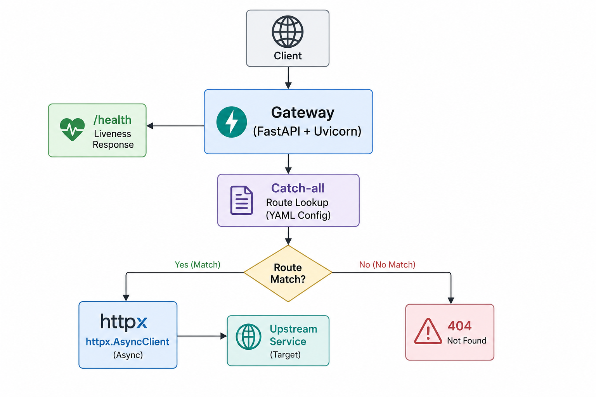

# async-gateway-proxy


An async API gateway / reverse proxy in Python. It receives HTTP requests,
picks a backend from a YAML routing table, forwards the request, and returns
the backend's response. It is built to sit in front of a custom multithreaded
C++ HTTP server.

The project is built in phases. This README describes what exists now
(up to Phase 3: core proxy, request tracing and API key auth). Later phases
are listed under [Roadmap](#roadmap).

## Architecture



What happens to one request:

1. Uvicorn accepts the TCP connection, parses the HTTP request and hands it
   to FastAPI as an ASGI call.
2. The request ID middleware gives the request an ID (the client's own
   `X-Request-ID` if it is well formed, a new UUID if not). Every log line
   for this request carries that ID.
3. The auth middleware checks the `X-API-Key` header. No key or an unknown
   key means `401`. `/health` needs no key.
4. `/health` is answered directly. Every other path hits one catch-all route.
5. `router.py` finds the longest `path_prefix` that matches the path. No
   match means `404`. If the key isn't allowed on that route, `403`.
6. `proxy.py` builds the upstream URL (prefix removed, query string kept as
   sent), cleans the headers (the API key is removed), adds `X-Request-ID`
   and `X-Gateway-Client`, and sends the request through a single shared
   `httpx.AsyncClient`.
7. The upstream's status, headers and body go back to the client with the
   same `X-Request-ID`. A timeout becomes `504`; a connection failure
   becomes `502`. One `request_completed` line is logged at the end.

Everything is async. While one request waits on its upstream, the event loop
serves other requests on the same thread.

## Features

- **Config-driven routing.** Routes live in `config.yaml`, validated by
  Pydantic at startup. A bad config stops the gateway from starting and
  reports every problem at once.
- **Longest-prefix matching** on path-segment boundaries: `/api` matches
  `/api/x` but not `/apix`.
- **Full forwarding** of method, path, raw query string, headers and body.
- **Header handling per RFC 7230:** hop-by-hop headers are dropped in both
  directions, including any header named in `Connection`. `Host` and
  `Content-Length` are set fresh for the upstream. `X-Forwarded-For` is
  appended to, never overwritten. Apart from the `X-Forwarded-*`,
  `X-Request-ID` and `X-Gateway-Client` headers, the gateway adds nothing
  of its own.
- **Bodies pass through untouched.** A gzipped upstream response reaches the
  client still gzipped, with its `Content-Encoding` intact. Repeated headers
  such as `Set-Cookie` are kept.
- **Connection pooling.** One `httpx.AsyncClient` for the life of the
  process, so keep-alive connections to each upstream are reused.
- **Distinct failure codes.** `504` for upstream timeout, `502` for an
  unreachable upstream, upstream `5xx` passed through as is.
- **Request IDs end to end.** Each request gets an ID that appears in every
  log line, goes to the upstream as `X-Request-ID`, comes back to the client
  in the response header and in error bodies. A client's own ID is kept if
  it is 1 to 128 characters of letters, digits and `. _ : -`; anything else
  is replaced.
- **API key auth.** Each key belongs to a named client and lists the routes
  it may use. Only SHA-256 hashes of keys are stored in config. The key is
  stripped before forwarding; the upstream gets the verified client name in
  `X-Gateway-Client` instead, and a client-sent copy of that header is
  always dropped. A client can hold two keys at once for rotation.
- **Structured JSON logs.** A `request_completed` line for every request
  (total `duration_ms`) and a `proxy_forward` line for every forwarded one
  (`upstream_ms`, request and response sizes). The gap between the two
  times is the gateway's own overhead.

## Project layout

```
app/
  main.py            app factory, lifespan, /health, catch-all route
  router.py          route matching and upstream URL building (pure functions)
  proxy.py           forwarding, header filtering, error mapping
  logging_config.py  JSON log formatter, request ID on every record
  request_context.py ContextVar holding the current request ID
  security.py        API key hashing, and a CLI to create keys
  middleware/
    request_id.py    assigns the ID, sets the response header, access log
    auth.py          checks X-API-Key (authentication)
  config/
    models.py        Pydantic schema for config.yaml
    loader.py        reads and validates the YAML file
dummy_upstream/
  main.py            small FastAPI backend for local testing
tests/               pytest suite, no network needed
config.yaml          routing table
```

## Run it locally

Needs Python 3.12 or newer.

```bash
python -m venv .venv
source .venv/bin/activate
pip install -r requirements-dev.txt

# Terminal 1: the backend
uvicorn dummy_upstream.main:app --port 8001

# Terminal 2: the gateway
uvicorn app.main:app --port 8000 --no-proxy-headers --no-access-log
```

Why the two flags:

- `--no-proxy-headers`: by default Uvicorn trusts `X-Forwarded-For` from
  localhost and rewrites the client address from it. The gateway is the edge,
  so it must record the real TCP peer, not a value the caller can fake.
- `--no-access-log`: the gateway writes its own `request_completed` JSON
  line for every request, so Uvicorn's access log would only duplicate it.

Environment variables:

| Variable         | Default       | Purpose                     |
|------------------|---------------|-----------------------------|
| `GATEWAY_CONFIG` | `config.yaml` | Path to the routing config  |
| `LOG_LEVEL`      | `INFO`        | Log level                   |

## Configuration

```yaml
upstream_timeout_seconds: 5.0     # optional, must be > 0

routes:                           # at least one route
  - path_prefix: /api             # must start with '/'
    upstream: http://localhost:8001

  - path_prefix: /cpp             # e.g. the C++ server
    upstream: http://localhost:8080
```

Validation rules: unknown keys are rejected (so a typo like `upstrem` fails
at startup), upstreams must be full URLs with a scheme, and duplicate
prefixes are rejected. Trailing slashes are normalized.

## Authentication

Add an `auth` section and every request except `/health` needs an
`X-API-Key` header. Remove the section and auth is off (the gateway logs a
warning at startup).

```yaml
auth:
  keys:
    - client: mobile-app                  # logged, and sent upstream
      key_sha256: 1968b315...             # SHA-256 of the key, never the key
      routes: [/api]                      # route prefixes this key may use
```

Create a key:

```bash
python -m app.security mobile-app --routes /api
```

It prints the key once, for the client, and the YAML entry with its hash.

| Request                              | Response |
|--------------------------------------|----------|
| No `X-API-Key`                       | `401` `missing api key` |
| Unknown key                          | `401` `invalid api key` |
| Valid key, route not in its `routes` | `403` |
| Valid key, path matches no route     | `404` |
| Valid key, allowed route             | proxied |

Design choices:

- **401 before routing.** Without a valid key every path returns 401, so a
  caller can't probe which routes exist. Authentication (who are you?) is
  middleware; authorization (may you use this route?) runs after routing,
  because it needs the matched route.
- **Hashes, not keys, in config.** The config file can sit in git or a
  Kubernetes ConfigMap without leaking a usable key. SHA-256 is enough
  because keys are 256 random bits; slow password hashes like bcrypt exist
  for guessable human passwords and would add ~100 ms per request.
- **Lookup by hash.** The presented key is hashed, then looked up in a
  dict. Comparing raw strings can leak through timing how much of a guess
  was right; comparing hashes the attacker can't steer leaks nothing useful.
- **Keys never reach upstreams or logs.** Even a wrong key isn't logged,
  since it is often a real key pasted in the wrong place.
- **Rotation.** List a second key for the same client, move the client to
  it, then delete the old entry.

## Try it

The bundled `config.yaml` has one key for local development only:
`gw_dev_local_only`. It's public, so delete it before deploying anywhere.

```bash
K="X-API-Key: gw_dev_local_only"

# Liveness, no key needed
curl localhost:8000/health
# {"status":"ok"}

# No key / wrong key
curl -i localhost:8000/api/items/42
# 401 {"error":"missing api key","request_id":"..."}
curl -i localhost:8000/api/items/42 -H "X-API-Key: nope"
# 401 {"error":"invalid api key","request_id":"..."}

# Proxied GET: /api/items/42 -> http://localhost:8001/items/42
curl localhost:8000/api/items/42 -H "$K"
# {"item_id":42,"name":"item-42"}

# The echo endpoint shows what the upstream received: no x-api-key,
# x-gateway-client: local-dev, even if the caller tries to fake it
curl localhost:8000/api/echo -H "$K" -H "X-Gateway-Client: admin"

# Proxied POST
curl -X POST localhost:8000/api/echo -H "$K" \
  -H "Content-Type: application/json" \
  -d '{"hello":"world"}'

# Your own request ID is kept, sent upstream, and returned
curl -i localhost:8000/api/echo -H "$K" -H "X-Request-ID: demo-42"
# x-request-id: demo-42   (and "x-request-id": "demo-42" in the echoed headers)

# No matching route
curl -i localhost:8000/nope -H "$K"
# 404 {"error":"no matching route","path":"/nope","request_id":"f046eddc-..."}

# A real timeout: the upstream waits 6 s, the gateway gives up after 5 s
curl -i "localhost:8000/api/slow?delay=6" -H "$K"
# 504 {"error":"upstream timeout","request_id":"..."}

# Stop the dummy upstream, then:
curl -i localhost:8000/api/items/1 -H "$K"
# 502 {"error":"upstream unavailable","request_id":"..."}
```

The two log lines for one proxied request share its ID, and the access line
names the client:

```json
{"ts": "2026-10-29T14:46:55.873+00:00", "level": "info", "logger": "gateway.proxy", "message": "proxy_forward", "request_id": "d254920c-ec7c-41ae-902f-3ee633e85b38", "method": "GET", "path": "/api/items/1", "upstream": "http://localhost:8001/items/1", "status_code": 200, "upstream_ms": 30.82, "request_bytes": 0, "response_bytes": 29}
{"ts": "2026-10-29T14:46:55.874+00:00", "level": "info", "logger": "gateway.access", "message": "request_completed", "request_id": "d254920c-ec7c-41ae-902f-3ee633e85b38", "method": "GET", "path": "/api/items/1", "status_code": 200, "duration_ms": 32.97, "client_ip": "127.0.0.1", "client": "local-dev"}
```

A rejected request:

```json
{"ts": "2026-10-29T14:46:55.832+00:00", "level": "warning", "logger": "gateway.auth", "message": "auth_rejected", "request_id": "972cf647-77ca-493e-b533-62694d4b4a84", "reason": "invalid api key", "method": "GET", "path": "/api/items/1"}
```

To find everything about one request: `grep d254920c gateway.log`.

## Tests

```bash
pytest
ruff check . && ruff format --check .
```

The proxy tests swap httpx's network transport for `httpx.MockTransport`,
so they cover forwarding, header rules, gzip passthrough, timeouts and
connection failures without opening a socket. One test runs 20 requests
concurrently and checks that none of them logs another's request ID. The
auth tests cover each response code, key stripping, identity spoofing and
key rotation. CI runs lint and tests on Python 3.12, 3.13 and 3.14 for
every push.

## Limitations

- Request and response bodies are read fully into memory. Large uploads,
  downloads and server-sent events need streaming (Phase 6).
- No rate limiting, retries or circuit breaking yet.
- API keys don't expire and can't be revoked without a restart (hot reload
  comes in Phase 7). Key hashes live in the config file; in Kubernetes
  (Phase 10) they move to a Secret.
- No JWT or OAuth. Static API keys suit service-to-service calls; user
  login would need tokens with expiry and scopes.
- `/health` is liveness only. There is no readiness check against upstreams.
- Config is read once at startup. Changing it needs a restart.
- httpx timeouts apply per operation (connect, each read), not as one total
  deadline for the request.
- One upstream URL per route, so no load balancing across replicas.
- HTTP only. TLS is expected to end at an ingress in front of the gateway.
- Any client's well-formed `X-Request-ID` is trusted. A production edge
  proxy would usually trust it only from known internal callers.
- Request IDs are not full distributed tracing: there are no spans or
  parent/child timings. OpenTelemetry would add that.

## Roadmap

| Phase | Adds |
|-------|------|
| 1     | Core proxy, config, logging, tests, CI (done) |
| 2     | Request IDs propagated to upstreams and logs (done) |
| 3     | API key authentication with per-key route access (done) |
| 4     | Token-bucket rate limiting (in-memory, then Redis) |
| 5     | Retries with backoff and jitter, retry budget, circuit breaker |
| 6     | Streaming bodies and graceful shutdown |
| 7     | Readiness probe, Prometheus metrics, config hot reload |
| 8     | Docker and docker-compose (gateway, upstream, C++ server, Redis, Prometheus) |
| 9     | Load testing and benchmarks against direct and NGINX baselines |
| 10    | Kubernetes manifests and deployment on a k3s VPS |
